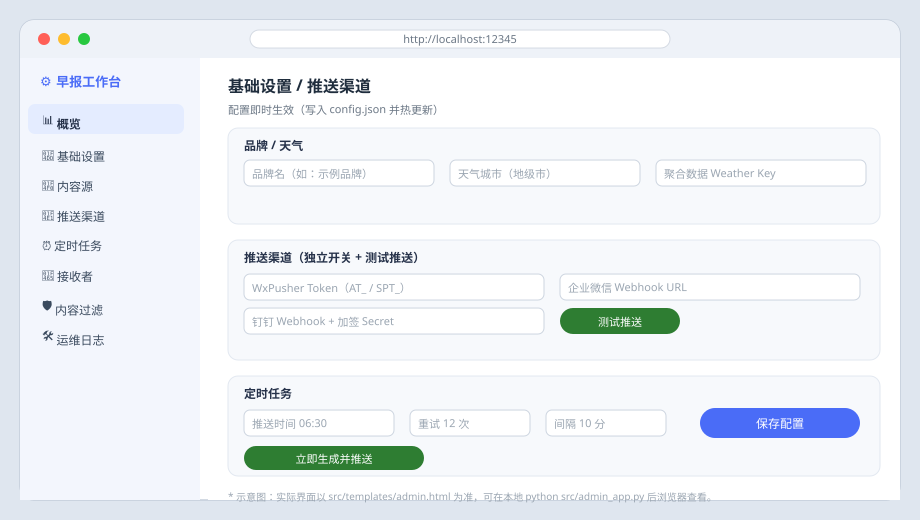
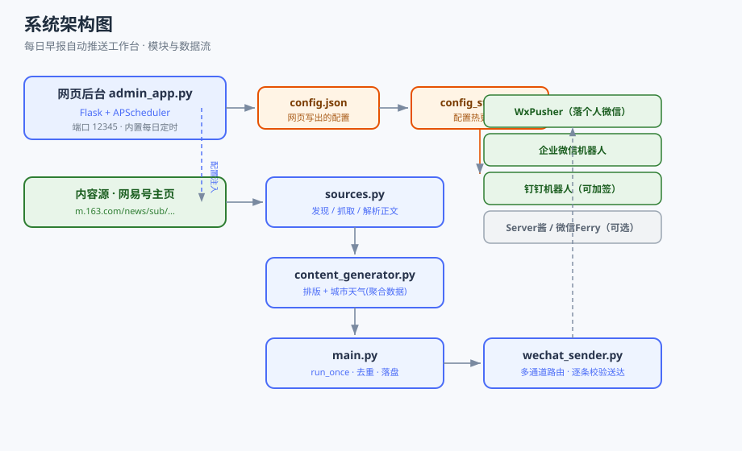
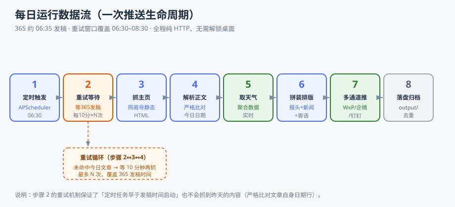

# 每日早报自动推送工作台 · Daily Briefing Workbench

<p align="center">
  <a href="LICENSE"></a>
  
  
  
</p>

> 自动抓取《365资讯简报》当日内容 → 清洗排版为「品牌报头 + 当地天气 + N 条新闻 + 寄语」→ 经**已验证的推送渠道**（WxPusher / 企业微信 / 钉钉）定时发送到你的微信 / 群。纯 HTTP、锁屏可跑、配置驱动、开箱即用。

### 📌 这是什么 · 适合谁

- **做什么**：把每天更新的《365资讯简报》自动排版成「品牌报头 + 当地天气 + 精选新闻 + 寄语」的消息，按设定时间推送到你的微信（个人微信 / 企业微信群 / 钉钉群）。
- **适合谁**：想**每天自动、稳定**收到或转发一份早报的个人 / 团队；不想降级微信、不想开着桌面、希望**服务器 / 小主机 7×24 无人值守**运行的人。
- **不适合谁**：希望"搬运公众号原文带图带链接"的——本项目只做**文本排版转发**，不处理原文图文。

---

## 📑 目录

- [📌 这是什么 · 适合谁](#这是什么--适合谁)
- [✨ 功能特性](#功能特性)
- [🖼 效果示意图](#效果示意图)
- [🏗 项目架构](#项目架构)
- [🎨 设计原则](#设计原则)
- [📁 目录结构](#目录结构)
- [🚀 快速开始](#快速开始)
- [⚙️ 配置说明](#配置说明)
- [📡 各推送渠道配置](#各推送渠道配置)
- [🔐 安全与隐私规则](#安全与隐私规则开源必读)
- [🧰 命令行与运维](#命令行与运维)
- [❓ 常见问题与排错](#常见问题与排错)
- [📄 许可证](#许可证)

---

## ✨ 功能特性

- **自动发现当日简报**：从《365资讯简报》的网易号固定主页（静态 HTML）抓取并严格比对日期，自动避开"昨天内容"陷阱。
- **智能排版**：自动生成 `【品牌】观天下・知今朝！` 报头、日期/农历/星期、当地实时天气、新闻列表与收尾寄语。
- **多通道同步推送**：WxPusher（落个人微信）、企业微信机器人、钉钉机器人可同时启用；另预留 Server酱 / 微信 Ferry 接口。
- **网页后台**：内置 Flask 管理界面（端口 `12345`），可视化配置天气、渠道、定时、过滤规则，保存即生效。
- **内置定时调度**：APScheduler 每日按设定时间触发，并带"等发稿"重试窗口（默认 06:30 起、每 10 分钟重试，覆盖 365 约 06:35 发稿）。
- **锁屏友好**：全程纯 HTTP 请求，无需微信桌面端、无需解锁屏幕、无需降级微信，适合服务器 / 小主机 7×24 无人值守。
- **内容过滤**：可配置屏蔽地域、敏感词、员工相关词，满足"智能筛选、不机械过滤"的需求。

---

## 🖼 效果示意图

后台管理界面（示意图，实际以 `src/templates/admin.html` 为准）：



---

## 🏗 项目架构





| 模块 | 职责 |
|---|---|
| `sources.py` | 内容源发现 / 抓取 / 解析（含重试等待发稿、严格日期比对） |
| `content_generator.py` | 解析正文、调用天气接口、拼装最终早报消息 |
| `wechat_sender.py` | 多通道路由与发送，逐条校验送达状态（避免"显示成功却没收到"） |
| `main.py` | 编排一次推送（`run_once`）、去重、落盘 |
| `config_store.py` | 配置热更新层：`config.py` 默认值 + `config.json` 覆盖 |
| `admin_app.py` | Flask 网页后台 + APScheduler 内置定时调度（端口 12345） |
| `templates/admin.html` | 后台单页界面 |

---

## 🎨 设计原则

本项目不是为了"炫技"，而是被三条**硬约束**逼出来的工程取舍：

1. **约束驱动（Constraint-First）**
   - 用户微信是 4.x，WeChatFerry 只支持 3.9.x → **不降级**，因此放弃"直接操作微信客户端发消息"，改为"API 推送通道"。
   - 电脑下班后**必须锁屏** → 一切需要可见桌面的 UI 自动化（截图 OCR、pyautogui）被排除，只保留无头纯 HTTP 方案。
2. **配置驱动 / 通用化（Config-Driven）**
   - 所有品牌名、城市、密钥、过滤词、定时全部外置；换电脑 / 换账号只改配置，不改代码。
   - 提供 `config.py`（默认）+ `config.json`（覆盖）双层配置，且网页后台可直接改。
3. **通道可插拔（Pluggable Channels）**
   - 推送通道抽象为统一接口，按 `DELIVERY_CHANNELS` 顺序尝试；某个通道失效不阻塞其它通道。
4. **透明可观测（Observable）**
   - 每一步都有日志，发送后**逐条核验送达 code**（而非仅看 HTTP 200），并支持"测试推送"与失败告警。
5. **最小依赖 / 轻量**
   - 核心仅 `requests` + `Pillow`；网页后台才需要 `Flask` + `APScheduler`，Docker 镜像基于 `python:3.11-slim`。

---

## 📁 目录结构

```
.
├── README.md                 # 本文件
├── LICENSE                   # MIT
├── .gitignore                # 开源忽略规则（含密钥文件）
├── requirements.txt          # 本机运行依赖
├── config.example.json       # 配置模板（无真实密钥，复制为 config.json 后填写）
├── src/
│   ├── config.py             # 默认配置（已脱敏，密钥留空）
│   ├── config_store.py       # 配置热更新层
│   ├── content_generator.py  # 排版 + 天气
│   ├── sources.py            # 内容源抓取 / 解析
│   ├── wechat_sender.py      # 多通道发送
│   ├── main.py               # 编排 / 去重
│   ├── admin_app.py          # 网页后台 + 定时调度
│   └── templates/admin.html  # 后台界面
├── deploy/
│   ├── Dockerfile
│   ├── docker-compose.yml    # 飞牛 / 任意 Linux Docker
│   ├── requirements-docker.txt
│   └── README.md
├── docs/
│   ├── 安全与隐私.md          # 开源安全规则（必读）
│   └── 渠道配置.md            # 各推送渠道详细配置
├── images/                   # 架构 / 数据流 / 界面示意图
└── samples/
    └── 早报示例.txt           # 输出样例
```

---

## 🚀 快速开始

### 方式一：本机直接运行（推荐先验证）

```bash
# 1. 准备配置
cp config.example.json config.json
# 编辑 config.json，填入你自己的密钥（或用下面的网页后台填写）

# 2. 安装依赖
pip install -r requirements.txt

# 3. 启动网页后台（端口 12345）
python src/admin_app.py
# 浏览器打开 http://localhost:12345
```

打开后台后：填好各渠道 API → 点「保存配置」→ 点「立即生成并推送」验证一次。

### 方式二：Docker / 飞牛小主机（7×24 无人值守）

```bash
# 1. 准备配置（必须存在，Docker 挂载需要）
cp config.example.json config.json
# 编辑 config.json 填入你的密钥

# 2. 构建并启动
docker compose -f deploy/docker-compose.yml up -d --build

# 3. 访问 http://<主机IP>:12345
```

> ⚠️ 国内拉取 `python:3.11-slim` 若报 `401` / 超时，请在 Docker 设置里配置国内镜像源
> （如 `https://docker.m.daocloud.io`、`https://hub-mirror.c.163.com`），再重试。

---

## ⚙️ 配置说明

所有配置集中在 `config.json`（网页后台写出的覆盖层）。字段含义见 `config.example.json` 内注释，要点：

| 字段 | 说明 |
|---|---|
| `brand` | 报头品牌名 |
| `news_count` | 保留新闻条数（1–20） |
| `city` | 天气城市（**聚合数据免费接口仅支持地级市**，如"北京"） |
| `weather_key` | 聚合数据天气 API Key |
| `schedule.time` | 每日推送时间（HH:MM） |
| `schedule.max_attempts` / `interval_minutes` | 等 365 发稿的重试次数与间隔 |
| `channels.*` | 各通道开关与 API 入口 |
| `filters.*` | 屏蔽地域 / 敏感词 / 员工词 |

**两种改配置途径**：① 网页后台直接填；② 编辑 `config.json` 后重启（或后台点保存）。

---

## 📡 各推送渠道配置

完整图文步骤、所需权限、常见报错与验证命令见 **[docs/渠道配置.md](docs/渠道配置.md)**，要点速览：

| 通道 | 落点 | 是否到个人微信 | 是否需要企业/组织 |
|---|---|---|---|
| **WxPusher**（ClawBot） | 个人微信「微信ClawBot」会话 | ✅ | 否（微信扫码即用） |
| **企业微信机器人** | 企业微信群（经微信插件可到成员个人微信） | ✅（成员关注插件后） | 是（企业微信） |
| **钉钉机器人** | 钉钉群 | —（钉钉内） | 是（钉钉组织） |
| Server酱 | 微信「服务通知」 | ✅（格式较差） | 否 |
| 微信 Ferry | 文件传输助手 / 群 | ✅ | 需降级微信 3.9（不推荐） |

**企业微信消息转发到成员个人微信**：靠企业微信官方「微信插件」——管理员后台生成邀请二维码，成员用个人微信扫码关注并关闭"仅在企业微信中接收消息"，群消息即同步到个人微信。纯后台配置，**不改代码**。详见渠道配置文档 §5。

---

## 🔐 安全与隐私规则（开源必读）

本项目**已移除原作者所有私有配置**，但你在自行部署 / 二开时务必遵守以下规则（详细见 **[docs/安全与隐私.md](docs/安全与隐私.md)**）：

- ❌ **绝不**把 `config.json`、`config_local.py`、`*.log`、`output/` 提交到公开仓库（已写入 `.gitignore`）。
- ✅ 只提交 `config.example.json`（占位，无密钥）。
- ✅ 上传前用 `grep -rE "AT_|SPT_|SCT|webhook/send\?key|access_token|SEC[a-f0-9]" .` 自查，确认无真实密钥泄露。
- ✅ 若不慎提交过密钥，**立即吊销重置**（WxPusher 重置 token、企业微信重置机器人、钉钉重置 secret、聚合数据重置 Key），因为 Git 历史也会泄露。
- ✅ `ADMIN_PASSWORD` 用环境变量注入，**不要明文写死**在 `docker-compose.yml`。
- ✅ 后台端口 `12345` 不要裸奔到公网；如需外网访问请加反向代理 + 鉴权。
- ✅ 不要在 Issue / PR / 评论里粘贴任何密钥。

---

## 🧰 命令行与运维

| 目的 | 命令 |
|---|---|
| 启动后台 | `python src/admin_app.py` |
| 手动跑一次（不依赖调度） | 后台点「立即生成并推送」，或 `python src/main.py` |
| Docker 启动 | `docker compose -f deploy/docker-compose.yml up -d --build` |
| Docker 看日志 | `docker compose -f deploy/docker-compose.yml logs -f` |
| Docker 停止 | `docker compose -f deploy/docker-compose.yml down` |
| 查看今日早报样例 | 见 `samples/早报示例.txt` |

---

## ❓ 常见问题与排错

- **后台页面配置显示为空**：确认项目根目录存在 `config.json`（首次可从 `config.example.json` 复制）。后端接口正常，前端空白多为浏览器缓存，强刷（Ctrl+F5）即可。
- **抓到"昨天"的内容**：已通过文章自身日期行严格比对 + 重试窗口规避；若仍发生，检查 `schedule.time` 是否过早（早于 365 发稿）且无重试。
- **天气返回错误码 207301**：聚合数据免费接口不支持区县级城市，改为地级市（如"北京"）。
- **推送显示成功但没收到**：WxPusher 需关注应用 / 激活 ClawBot；企业微信需机器人 Webhook 有效；钉钉需加签正确。用后台「测试推送」逐通道验证。
- **Docker 拉镜像 401/超时**：配置国内 Docker 镜像源后重试。

---

## 📄 许可证

[MIT](LICENSE) © 2026 Daily Briefing Workbench Contributors

## 🙏 免责声明

- 《365资讯简报》内容为第三方来源，本项目仅做**自动化排版与转发**，版权与内容责任归原作者 / 来源方。
- 推送通道（WxPusher / 企业微信 / 钉钉 等）均为第三方服务，使用须遵守其平台规则与频率限制。
- 本项目按"现状"提供，作者不对因使用产生的任何后果负责。
